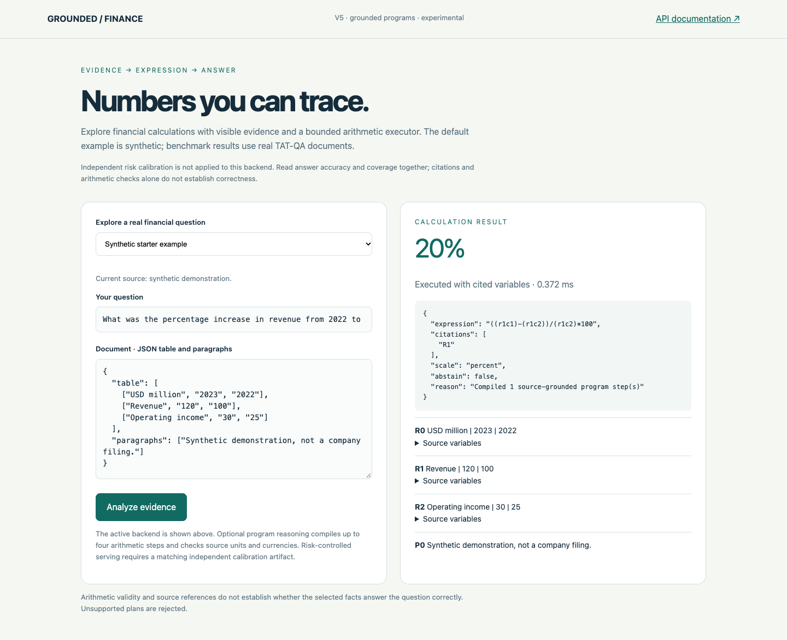
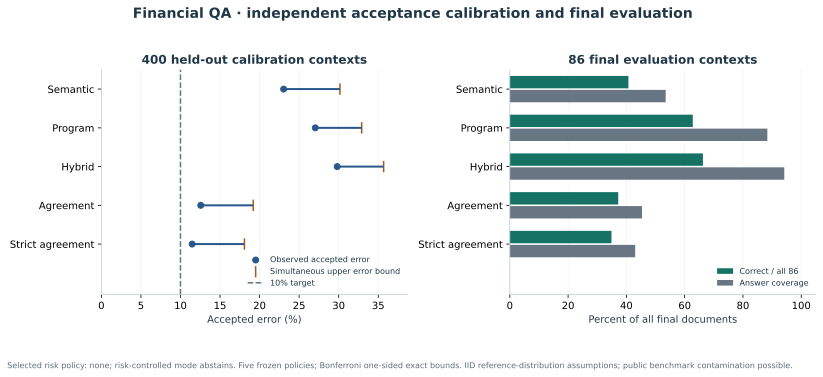

# Grounded Financial QA

[](https://github.com/adelmansourjr/financial-qa/actions/workflows/ci.yml)

**Source-integrity update:** a deeper audit found repeated tables and paragraphs
across ID-disjoint samples. Existing scores are descriptive, with unverified
filing independence. Future sampling now excludes whole source groups and records
shared reservations. See [the leakage and fit audit](docs/LEAKAGE_AND_FIT.md).


A local financial reasoning application with a small language model, constrained
source-grounded programs, bounded Decimal arithmetic, and an independently checked
abstention policy. The browser exposes the calculation, operands, sources and rejection
reason, and can load 40 real TAT-QA contexts without giving gold labels to the planner.

The opt-in `program-v5` candidate adds exact source-label resolution, explicit
operand metadata and bounded invalid-program repair. Its accuracy evaluation is
separate from the historical results below. See the
[v5 design and prospective evaluation protocol](docs/RESEARCH_V5.md).
The [v5 evidence report](docs/RESULTS_V5.md) distinguishes completed development
results from the subsequent frozen comparison.

The completed source-group comparison scored **66.0% overall** for v5 versus
**64.7% for v4**, with an inconclusive +1.33-point paired gain [-4.67, +6.67].
V5 answered 88.7% of questions, with 74.4% accuracy among answers and 34.86-second
p95 latency. It **did not meet the fixed 80% target**. Its 83% development score
did not carry over; v5 remains an opt-in research candidate.



The frozen v3 Qwen3-4B program model scored **54/86 correct (62.8%)**, with **88.4% answer
coverage**, on the final previously uninspected arithmetic contexts. Its accepted-answer
accuracy was 71.1%. Separate 400-context calibration **did not support the declared
10% accepted-error target**. Consequently, `risk-controlled` mode fails closed and
returns no numerical answers. This is a measured research prototype with remaining
semantic errors.



## Measured final results

| Frozen v3 policy | Correct / 86 | Answered / 86 | Accuracy | Accuracy when answered |
| --- | ---: | ---: | ---: | ---: |
| Semantic rules |35|46|40.7%|76.1%|
| Program model, preselected experimental default |54|76|62.8%|71.1%|
| Rule-first hybrid, descriptive comparison |57|81|66.3%|70.4%|
| Rule/model agreement |32|39|37.2%|82.1%|
| Strict agreement |30|37|34.9%|81.1%|
| Risk-controlled mode |0|0|0%|Not defined|

The experimental default was selected using 100 training-development contexts before
calibration and final scoring. Hybrid's higher final score is descriptive; it was not
promoted after viewing final outcomes. Model accuracy improved over semantic rules by
22.1 percentage points on the same 86 questions (paired context-bootstrap 95% interval:
11.6–33.7 points). Its overall accuracy interval is 52.3–73.3%; accepted accuracy
60.5–81.6%. These intervals do not remove the sampling and dependence limitations below.

A separate 400-context calibration used exact one-sided binomial upper bounds with
Bonferroni correction across five fixed policies. None met the 10% target. The strongest
bound was **18.09% error** for strict agreement, based on 21 errors among 183 accepted
calibration answers. This provides **no 90% accepted-accuracy guarantee**. The guarded
mode's refusal is intentional and visible in `/health` and the browser.

The live Metal model pass made 85 requests and rejected one context before generation
because it exceeded the fixed source budget. End-to-end p95 latency was 7.426 seconds,
including validation and rejected cases. Other policies replay identical saved programs;
their cache latency is not fresh model inference latency. The unmodified official
TAT-QA evaluator gives matching arithmetic-subset EM/F1 as a secondary check, **not a
full-benchmark leaderboard result**.

See [the concise results report](docs/RESULTS_V3.md),
[research, protocol and reproduction](docs/RESEARCH_V3.md),
[complete results and uncertainty](reports/v3-summary.json), and
[official secondary scoring](reports/v3-official-secondary.json).

## Run locally

Requires Python 3.11+ and `curl`. Tests and the default browser need no model server.

```sh
python3 -m venv .venv
.venv/bin/python -m pip install -e '.[dev]'
.venv/bin/financial-qa download --split dev
.venv/bin/financial-qa serve --port 8001
```

Open http://127.0.0.1:8001. The default `semantic` backend is deterministic. The initial
example is synthetic; the dropdown loads already explored real contexts. API schema:
http://127.0.0.1:8001/docs. Run these commands from the repository root.

For model reasoning, obtain the verified runtime and official Qwen3-4B Q4_K_M weights
using [the standalone runtime guide](docs/RESEARCH_V3.md#reproduce-on-a-laptop).
Then run:

```sh
.venv/bin/financial-qa serve --backend program-v3 --program-policy model \
  --llm-url http://127.0.0.1:18081/v1 --model qwen3-4b-q4-nonthinking --port 8001
```

The three optional model files occupy about 4.1 GB combined; only the single 2.5 GB 4B
file plus runtime is needed for v3. The measured run used Apple Silicon Metal;
CPU-only inference is supported by compatible llama.cpp builds and will have different
latency. No paid API or inference credentials are needed. Model weights, data, private
response caches and runtime binaries stay outside Git.

`--backend risk-controlled` checks the saved calibration evidence, model bytes, runtime
identity and code before accepting a policy. With the checked-in failed calibration
artifact it deliberately abstains. Experimental `program-v3` remains available with its
uncalibrated status clearly labeled. The serving-only identity guard additionally stops
answers after an ordinary model alias/path change.

## How it works

The model selects existing evidence IDs and a bounded sequence of symbolic operations;
it never supplies executable Python or arbitrary financial amounts. The compiler checks
operand references, currencies, dimensions, periods and program size, then derives
citations and expressions. The executor validates a small AST allowlist and computes
with Decimal. Arithmetic and citation validity cannot establish that the chosen
financial metric is correct.

[Architecture and trust boundaries](docs/ARCHITECTURE.md) explains the modules and API.
[Serving and CLI contracts](docs/SERVING.md) covers optional model configuration,
fail-closed startup and busy-request responses.
[Contributing](CONTRIBUTING.md) covers environment setup, tests and evaluation discipline.
[Release verification](docs/RELEASE_READINESS.md) documents the standalone checks and
the distinction between software quality and the unmet accuracy target.
The risk certificate and [criterion binding](reports/v3-criterion-binding.json) distinguish
the local numeric correctness rule from human financial truth.

## Scope and limitations

All 86 final contexts were frozen before scoring and excluded 191 previously explored
development contexts. Development used 100 training contexts; calibration used 400 different
training contexts. A TAT-QA context is a table-plus-paragraph example, not a verified
independent filing or company. Related contexts may share a filing; context disjointness
does not establish filing independence. Public data may also occur in model pretraining.

The conditional risk interpretation would require fixed policies and IID contexts from
the same distribution. It does not survive distribution shift automatically. Here no
policy qualified regardless. The error criterion is scale-aware numeric matching with
0.005 tolerance in the gold unit, not an assessment of all financial semantics.

This application reasons over a supplied prepared context. It does not perform PDF/OCR
extraction or search complete filings. Units and evidence selection remain imperfect;
compound or missing-data questions can be unsupported. The local interface has bounded
requests, safe model transport, correlation IDs and security headers, but is a local
research tool without public-service authentication or deployment controls.

## Historical experiments

Earlier data selections, code paths and measured reports remain available. Their
percentages use different contexts and must not be treated as paired v3 comparisons.

- [Version 2 experiment](docs/EXPERIMENT_V2.md): frozen 100-context comparison and
  [complete summary](reports/v2-summary.json).
- [Structured-v1 experiment](docs/EXPERIMENT.md): frozen 50-context comparison and
  [summary](reports/upgrade-comparison.json).
- Original weak baseline and 0.5B/1.5B pilots remain in `reports/baseline.json` and
  `reports/llm-*-pilot.json`; interrupted v3 development diagnostics are explicitly
  labeled as training-only pilots.

Historical `baseline`, `header`, `llm`, `structured`, `selective`, `hybrid`, and
`agreement` CLI backends remain selectable. The historical header/structured-v1 methods
assumed an average for one year included its predecessor; subsequent methods removed
that heuristic. Preserving them makes earlier results reproducible.

## Quality checks

```sh
.venv/bin/python -m pytest -q
.venv/bin/ruff check .
.venv/bin/ruff format --check .
```

Tests are offline and cover evidence/label separation, safe arithmetic, currencies and
units, protocol/cache failures, exact risk bounds, frozen membership, artifact integrity,
runtime drift and HTTP behavior. Software is MIT; dataset and model licenses are
specified separately in [DATA.md](DATA.md).

## Layout-aware experimental backend

The new `program-v4` backend preserves the source table layout, resolves local
units/observation periods, and generates short evidence analysis before bounded
arithmetic programs. It leaves the completed v3 study and its failed risk
certificate unchanged. Use it explicitly with the existing verified local model:

```sh
financial-qa serve --backend program-v4 --port 8001
```

See [the v4 protocol and implementation guide](docs/RESEARCH_V4.md) for development,
the frozen paired comparison on 200 unused public-training contexts, and the
limits of this arithmetic-subset study. The unfiltered `program-v4` backend is not independently risk-calibrated.
`risk-controlled` continues to use the original v3 certificate; the separate
`risk-controlled-v4` backend tests one narrower temporal-agreement policy on
300 new reference contexts and uses its own certificate. Read that result before
claiming any conditional reliability target was met.

The [completed v4 study](docs/RESULTS_V4.md) scores **131/200 (65.5%)** versus
v3 **124/200 (62.0%)** on the same new project-held-out public-training contexts.
The paired gain is +3.5 percentage points, 95% interval [-2.51,+9.00], so the gain
is inconclusive. Official arithmetic-subset EM/F1 agrees. The separate narrow
policy gets 90/95 accepted answers correct on 300 calibration contexts, but its
10.75% upper error bound still exceeds the 10% target; guarded-v4 abstains.
