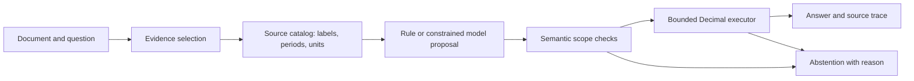

# Architecture and trust boundaries

The application answers arithmetic questions over an explicitly supplied financial
table and its accompanying paragraphs. It does not browse filings, trade securities,
or produce an investment recommendation.

## Modules

| Module | Responsibility |
| --- | --- |
| `data.py` | Label-free `Document` and `Evidence`; separate `Example` annotations for scoring; pinned public data download. |
| `retrieval.py` | Legacy BM25, coherent header-preserving selection, or complete small-document evidence. |
| `context.py`, `structured.py` | Preserved structured-v1 catalog, prompt, compiler, and historical baseline. |
| `selective.py` | Version 2 scoped catalog, semantic rules, constrained proposals, temporal normalization, and selective policies. |
| `reasoning_v3.py` | Question-conditioned program grammar, source currencies/dimensions, program compiler, five fixed policies, and runtime-bound risk planner. |
| `calibration.py` | Exact finite-grid conditional-error bounds, strict calibration membership and evidence-recomputed artifact validation. |
| `model_client.py`, `risk_serving.py` | Bounded loopback transport, redirect rejection, private caches, runtime and serving model-identity checks. |
| `http_guard.py` | Request-size enforcement, correlation IDs, bounded error handling and local security headers. |
| `executor.py` | AST allowlist, cited-variable validation, bounded Decimal arithmetic, division-by-zero handling. |
| `service.py` | The single inference path used by CLI, API, and evaluations. |
| `evaluation.py`, `benchmark.py` | Local numeric scorer, frozen document manifests, coverage and paired document bootstrap. |
| `storage.py` | Atomic JSON artifacts, HTTPS-only public downloads, provenance receipts. |
| `api.py`, `static/` | Validated local API and browser evidence explorer; real demo contexts exclude gold labels. |

## Preserved v3 path

The optional 4B model emits a bounded symbolic program, with at most four steps over
existing source variables or earlier intermediate results. Simple explicit questions
use a one-operation grammar. The compiler checks currencies, dimensions, references,
periods and size before the shared arithmetic executor runs. It does not execute
model-generated Python.

`program-v3` is experimental and defaults to the model policy selected on training
development data. `risk-controlled` loads separate ID-disjoint calibration evidence and
recomputes finite-policy bounds before enabling answers. The current 400-context
calibration qualified no policy, so guarded mode intentionally abstains. `/health`
and `/answer` expose this state and its reason.

Runtime/code drift and ordinary model alias/path changes fail closed. Serving checks
only restrict availability; they do not modify frozen experiment predictions. Source
metadata and checksums are not attestation of an actively malicious local server.

See [measured results](RESULTS_V3.md) and [protocol](RESEARCH_V3.md).

## Layout-aware v4 path

`grounding_v4.py` builds label-free layout metadata over the original table and
paragraphs. It distinguishes observation periods from years embedded in entity
names and resolves cautious local units without inventing unknown dimensions.
`reasoning_v4.py` constructs a bounded analysis/program prompt and compiles at
most four operations through the existing Decimal executor. `program_cache_v4.py`
enforces actual-read and parse limits on response artifacts.

`selective_v4.py` adds one separate, fixed temporal-agreement gate. Its necessary
question/year prefilter skips generation only when acceptance is already
impossible. The full denominator retains these abstentions. Strict certificate
validation recomputes accepted/error counts and the one-sided exact bound from
all 300 calibration records, binding code, data, manifest and environment.

The completed comparison does not establish a significant accuracy gain, and the
new certificate fails its 10% upper-error target. `program-v4` remains explicitly
experimental; `risk-controlled-v4` fails closed. See [the completed study](RESULTS_V4.md).
These modules do not modify the ten frozen v3 prediction components.

## Preserved selective version 2 policies

`semantic` identifies an explicit operation and uniquely matching metric/periods.
It abstains when it cannot determine the requested operand set. Comparisons can use
years in rows or columns. It preserves unknown source units, excludes years as header
operands, and handles per-share exceptions and explicit percentage columns.

`selective` lets the small local model select a supported operation and existing
variable IDs under a dynamic JSON schema. An explicit question operator overrides a
conflicting two-operand change operator. A two-period temporal change is compiled as
newer minus older. This is deterministic interpretation of question text and source
headers; it never consults the expected answer.

`hybrid` tries the semantic rule first and uses the selective model only after rule
abstention. `agreement` accepts a selective model proposal only when its executed
value and scale match the independent semantic rule. Policy agreement is evidence
of consistency, not proof of truth: both methods can misunderstand the same table.

All version 2 model policies reject duplicate operands, incompatible or mixed unknown
units, unsupported operations, and observations outside explicitly requested years.
An average in one year cannot silently include the previous year. Model-provided
monetary scale labels cannot replace source-derived units.

## What the checks establish

The model cannot supply executable Python or arbitrary literal amounts. It chooses
from source variable IDs and a small operation vocabulary. Citations and expressions
are constructed by the compiler. The executor accepts only arithmetic syntax,
source-grounded names, and the constants `0`, `1`, and `100` used for averaging/percentages.

These checks establish arithmetic and trace consistency. They do **not** establish
that a row describes the intended financial metric, that a subtotal is appropriate,
or that an unknown unit is recoverable. Explicit abstention and unconditional
accuracy therefore remain part of every benchmark.

The local model endpoint must be loopback. Serving user documents does not cache
them. Evaluation response caches can contain source documents and are ignored by Git.
Requests and model context have size budgets; a rejected context is an abstention,
not a truncated answer. The HTTP app binds to localhost by default.

## Reproducibility boundaries

Historical `baseline`, `header`, `llm`, and `structured` methods remain available;
version 2 logic lives in `selective.py` and v3 logic in separate modules. Reports record the backend, frozen
manifest hash and all outcomes. Historical v2 uses the fixed 1.5B quantized checkpoint; v3 uses a fixed 4B checkpoint.
No weight fine-tuning occurs. A replay measures software/cache latency, so live model
latency reports must be preserved separately.

## Source isolation for future studies

`split_integrity.py` joins shared tables/informative paragraphs transitively and
blocks whole consumed groups. `source_reservations.py` serializes source-only
reservations with a writer lock and write-ahead ledger; a publication crash still
consumes its selected groups. `scripts/audit_leakage.py` pins train/dev snapshots,
checks completed consumption and validates future manifests against the ledger.
Historical prediction code remains frozen. These guards do not establish unique
filings or absence of pretraining exposure. See [the audit](LEAKAGE_AND_FIT.md).
