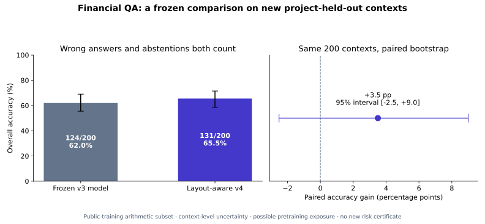
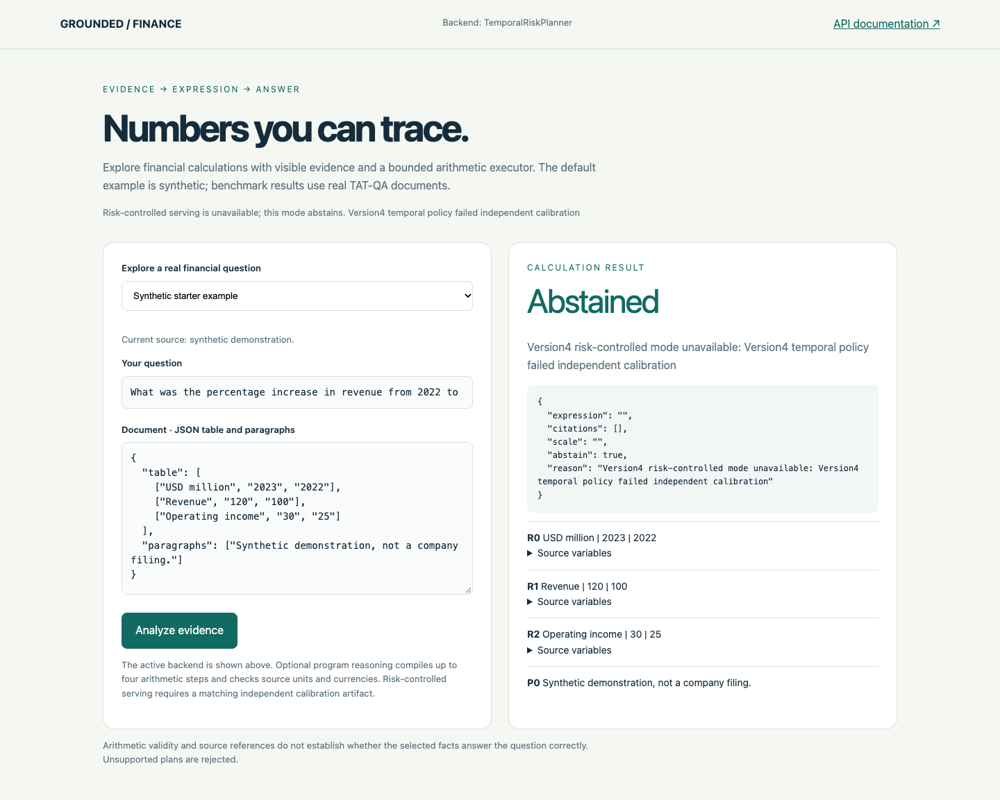

# Layout-aware QA: completed comparison and calibration

**Later source audit:** different context IDs repeat some tables/paragraphs across
samples. Independence and IID assumptions remain unverified; saved scores/bounds
are not evidence of filing independence. Predictions and failed certificates are
preserved. Read [the findings and new guards](LEAKAGE_AND_FIT.md).

The new layout-aware model has a higher point score, but the paired result is
inconclusive. Its narrower temporal-agreement policy has high observed accepted
accuracy but still fails the predeclared confidence-bound target. Both findings
are preserved; no prompt, policy or threshold was retuned against these outcomes.

## Paired comparison on 200 new contexts

These are previously unused **public-training** contexts, one arithmetic question
per context. They exclude all 608 contexts used by earlier project development
and calibration. This is a project-held-out arithmetic study, not an official
hidden-test result or protection against model pretraining exposure.

| Method | Correct / 200 | Answered / 200 | Overall accuracy | Correct among answers | Live end-to-end p95 |
| --- | ---: | ---: | ---: | ---: | ---: |
| Frozen v3 model | 124 | 178 | 62.0% | 69.7% | 9.18 s |
| Layout-aware v4 | 131 | 182 | 65.5% | 72.0% | 10.81 s |

The paired gain is **+3.5 percentage points**, with a 95% context-bootstrap
interval **[-2.51, +9.00]** using 1,000 resamples. The interval crosses zero and
does not meet the predeclared criterion for establishing an accuracy improvement.
V4 makes 51 accepted errors and abstains on 18 questions. It is an explicit
experimental alternative, without automatic promotion to the default.

Both methods generated 200 new local responses. V4 reused the same cache directory
but generated distinct requests; its cache grew from 200 to 400 entries. These
are live-run latencies, unlike the earlier cached development replay. The increased
v4 p95 is a real latency tradeoff. The actual pinned official TAT-QA scorer confirms
arithmetic-subset EM/F1 of 62.0% and 65.5%; official scale accuracy is 82.5%
and 82.0%, respectively. This is not a full leaderboard score.

## Fresh single-policy calibration

The one temporal-agreement gate was developed only on the original 100 development
contexts and fixed before calibration. It requires an explicit two-period temporal
comparison, two same-row money/count sources with known observation years, and
numeric/scale agreement between the model and an independent semantic rule.

The 300 fresh reference contexts exclude all 608 historical contexts and the 200
comparison contexts. Question-type/year-count prefiltering avoids 140 unnecessary
generations without changing acceptance conditions. The 160 eligible questions
remain part of the same 300-context denominator.

| Calibration quantity | Result |
| --- | ---: |
| Evaluated contexts | 300 |
| Accepted answers | 95 |
| Correct accepted answers | 90 |
| Incorrect accepted answers | 5 |
| Coverage | 31.7% |
| Observed accuracy among accepted answers | 94.7% |
| One-sided 95% upper accepted-error bound | **10.75%** |
| Predeclared maximum error target | **10.00%** |
| Decision | **Does not qualify; fail closed** |

Observed 94.7% accuracy does not establish the required bound. The exact
Clopper-Pearson upper bound is 0.1074769402, above 0.10. The single-policy test
uses alpha 0.05, with no policy search on calibration. Support exceeds the minimum
20 accepted contexts, but the error bound still fails. `risk-controlled-v4`
therefore starts explicitly unavailable and abstains. The original v3 guarded
backend and failed five-policy result remain unchanged.

The bound concerns the local scale-aware numeric criterion, not expert verification
of financial truth. Its statistical interpretation assumes IID reference contexts
and the same future distribution. Exact normalized-content overlap is zero within
and between the three samples, but distinct contexts can share source filings.
Filing independence and pretraining contamination remain unresolved.

## What changed and what remains

V4 preserves original table layout, separates observation years from years in
entity names, fixes cross-row percentage contamination, and resolves cautious local
units. A short source analysis precedes a bounded symbolic program. Explicit simple
questions have operation-specific grammars; compound requests retain multi-step
programs. Cached files and model responses have actual-read/parser budgets.

On training development, v4 improved from 66/100 to 72/100 correct, with 88 answers
and 81.8% accepted accuracy. That selected candidate justified the new experiment;
it is not independent accuracy evidence. Interrupted pilots are retained. The
completed held-out and calibration outcomes cannot be used as fresh development
data while still calling them untouched evaluation.

The source, manifest, runtime, environment, scoring and statistical identities
remain frozen. Before any calibration requests, two documented operational
preflights fixed checkpoint capacity and added the necessary-condition prefilter.
Membership, target and acceptance conditions did not change. No model weights or
datasets were downloaded for this experiment; the existing verified local 4B
model ran on the laptop's integrated Metal GPU.

## Evidence and reproduction

- [Frozen comparison policy](../benchmarks/policy-v4.json)
- [Comparison summary](../reports/v4-summary.json)
- [Actual official secondary scoring](../reports/v4-official-secondary.json)
- [Calibration policy](../benchmarks/calibration-policy-v4.json)
- [Calibration outcomes](../reports/v4-temporal-calibration.json)
- [Failed narrow-policy certificate](../reports/v4-temporal-certificate.json)
- [Normalized source-content overlap audit](../reports/v4-content-overlap-audit.json)
- [Implementation, protocol and reproduction commands](RESEARCH_V4.md)

## Serving check

The actual `risk-controlled-v4` API and installed Chrome desktop/mobile UI were
checked with the failed certificate, without response mocks or a running model.
Both health and answers expose `uncertified_fail_closed`, and the example abstains.
Reproduce against a running loopback service with `scripts/browser_guarded_v4.cjs`;
set `PLAYWRIGHT_MODULE` and `CHROME_EXECUTABLE` to existing installations.

