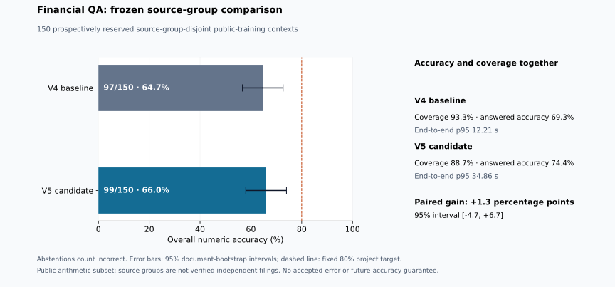

# V5 results and evidence status

## Completed fresh comparison

V5 scored **99/150 (66.0%)** on the prospectively reserved source groups, versus
v4's **97/150 (64.7%)** on the same questions. The paired gain was **+1.33 percentage
points**, with a 95% context-bootstrap interval of **[-4.67, +6.67]**. Both fixed
targets failed: overall accuracy remained below 80%, and the improvement interval
included zero. V5 remains experimental and is not promoted as a proven replacement.

| Metric | V4 baseline | V5 candidate |
| --- | ---: | ---: |
| Correct / evaluated | 97 / 150 | 99 / 150 |
| Overall numeric accuracy | 64.7% | 66.0% |
| Answered / evaluated | 140 / 150 | 133 / 150 |
| Coverage | 93.3% | 88.7% |
| Accuracy among answers | 69.3% | 74.4% |
| End-to-end p95 latency | 12.21 s | 34.86 s |
| Official arithmetic-subset EM/F1 | 64.0% | 65.3% |

The official secondary scorer is the hash-verified upstream evaluator. Its
slightly different result is retained separately from the local numeric-tolerance
criterion. This is a public-training arithmetic subset, not a leaderboard test.
The runs used existing local Qwen3-4B weights and no paid inference. The reported
p95 includes bounded proposal repairs; it is a substantial latency cost.

The development-to-comparison drop from 83% to 66% shows that the development
gain did not reliably generalize. Repeated development selection, source-group
distribution differences and small-sample variation can contribute; this study
does not isolate their causes. No code or threshold was retuned after viewing
these fresh outcomes. The 150 groups are now consumed and must not be reused as
untouched test data for another improvement claim.

Evidence: `reports/v5-summary.json`, the two `v5-comparison-*.json` reports,
`reports/v5-official-secondary.json`, `reports/v5-figure-data.json`, and the frozen
`benchmarks/policy-v5.json` / `benchmarks/future/v5-comparison.json` binding.

## Completed development experiments

These results reuse the original 100 training-development contexts. They measure
engineering progress on an inspected set, rather than accuracy on unseen reports.
All abstentions count as incorrect in the overall score.

| Revision | Correct | Answered | Overall accuracy | Accuracy among answers |
| --- | ---: | ---: | ---: | ---: |
| Frozen v4 | 72 | 88 | 72.0% | 81.8% |
| V5 with raw source references | 76 | 91 | 76.0% | 83.5% |
| V5 with descriptive source references | 83 | 95 | 83.0% | 87.4% |
| Final candidate with period guards and typed arithmetic | 83 | 95 | 83.0% | 87.4% |

The two completed v5 reports remain in `reports/`. Their changing source modules
are archived in `benchmarks/development-snapshots-v5.json`; tests verify each
snapshot against its measured report identity. Interrupted development pilots
are retained separately and are not included as completed accuracy evidence.

## Subsequent corrections

The candidate now distinguishes supported beginning/end or named-month changes
within a year from a prior-year comparison. Explicit subannual requests cannot
silently fall back to an unrelated prior-year amount. The exact resolver delegates
these questions to the model/compiler so it cannot bypass the period checks.
Quarters, unsupported date formats and ambiguous period pairs remain rejected.

A typed amount divided by a documented percentage share can recover its total,
preserving the amount's unit and requiring aligned source periods. An unspecified
amount or rate does not establish that relationship. The language model still
must select the financially relevant metric; arithmetic validity is insufficient.

The final report, `reports/v5-development-candidate.json`, binds these corrections
and records 83/100 with 95 answered. The identical aggregate to the preceding
revision does not imply identical per-question predictions. The earlier 83.0%
result remains bound to its archived revision.

## Prospective design and decision

After validating the final development report and fixing the candidate identity,
the runner reserved 150 source-group-disjoint public-training contexts.
Its predeclared targets are 80% overall numeric accuracy and a paired bootstrap
95% improvement interval above zero against frozen v4. These are project targets,
not an industry-wide reliability standard.

The full policy, sample reservation, data, runtime, inference and scoring code are
bound to the study. Changed targets, membership, policy fields or code invalidate
the comparison. A fresh result may confirm or fail the targets; neither outcome
permits silently changing the policy or resampling the same study.

See [the design and reproduction instructions](RESEARCH_V5.md) and
[the development diagnosis](DEVELOPMENT_ERROR_ANALYSIS_V5.md). Historical source
overlap and possible model pretraining contamination remain documented limitations.
V5 has no accepted-error certificate and remains a human-reviewed research tool.
